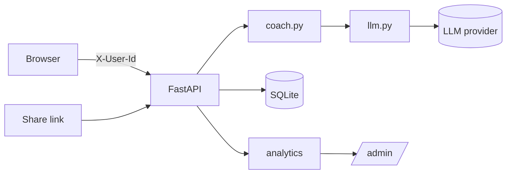

# PrepPilot: AI mock interview coach

> **Live demo:** https://preppilotv3.onrender.com/ · **Built by:** Kamalnath R · **Tests:** `pytest` (18 passing)

PrepPilot gives job-seeking engineers on-demand interview practice: **adaptive questions, AI follow-ups, rubric-based scoring, a readiness score and a personalized 7-day study plan**, with progress tracked per user and a built-in analytics dashboard for the product owner.

## 1. Problem and users
**User:** final-year students and early-career engineers preparing for fresher or junior roles.
**Problem (hypothesis):** human mock interviews are scarce and expensive, so most learners go into interviews with little practice and no objective read on their gaps.
**Job to be done:** "Tell me honestly how ready I am and what to do this week."
Full details: [`docs/PRD.md`](docs/PRD.md) (goals, non-goals, prioritization, launch plan, pricing hypothesis).


## 2. Features
| Area | What it does |
|---|---|
| Interview | 3, 5 or 10 adaptive questions; difficulty rises or falls with performance; optional follow-up question after each answer; optional background field to tailor questions |
| Scoring | Hidden per-question rubric (key points), scores for correctness, depth and communication, feedback and missed points |
| Report | Difficulty-weighted readiness score (0 to 100), strengths, weaknesses, 7-day plan, save as PDF, opt-in **shareable report card** link (scores and plan only, revocable) |
| Progress | Each browser sees only its own sessions, with a readiness trend chart and the change since the last session on the same topic |
| Trust | "Was this score fair?" 👍/👎 on every score, integrity flags, judge-ideas-not-English rule |
| Privacy | Anonymous per-browser identity, "Delete my data" button (also revokes share links), no answer text in analytics, share page never shows questions or answers |
| Owner tools | `/admin` dashboard: completion, drop-off, readiness by topic, latency, tokens, flag rate, fairness rate, comments |

## 3. Success metrics
| Type | Metric |
|---|---|
| North star | Users completing 3+ sessions in 14 days with a rising readiness score |
| Activation | % of visitors completing a first session |
| Quality | Fairness thumbs-up rate; eval pass rate; run-to-run score variance |
| Engagement | Follow-up answered rate |
| Guardrails | Integrity flag rate, p95 latency, tokens per session, daily cap hits |

## 4. Architecture
Diagrams (system overview, one interview turn, data and trust boundaries): [`docs/ARCHITECTURE.md`](docs/ARCHITECTURE.md).



## 5. Key decisions and trade-offs
- **Hidden rubric per question.** The model first writes the key points a strong answer must cover, then scores against them. This is more consistent than "rate this answer". Key points are never sent to the browser.
- **Deterministic logic outside the LLM.** Difficulty adaptation, the readiness score and the follow-up blend (80% answer, 20% follow-up) are plain code in `coach.py`, so they are stable, unit-tested and explainable.
- **Structured outputs with self-repair.** Every LLM call is validated with Pydantic and retried once with the validation error.
- **Provider-agnostic LLM layer.** Switching between free (Groq) and paid (Anthropic) models is an env change, so I can compare models on quality, cost and latency using the eval suite.
- **Untrusted input.** Answers, follow-ups and the background field are tagged as untrusted; injection attempts are an eval case.
- **Integrity: friction in the browser, signals on the server.** Question copying and answer pasting are disabled to mimic a real interview. Because client rules are bypassable, the server also receives telemetry (paste attempts, tab switches, keystrokes vs. length, speed) and **flags** suspicious answers instead of blocking, since false positives (voice typing, accessibility tools) would hurt honest users. Flags appear in the report. Limits: screenshots, retyping the question elsewhere, spoofed telemetry.
- **Fairness.** The scoring prompt says to judge ideas, not English fluency, and a non-native-English eval case guards against regression. Users can rate any score as unfair.
- **Anonymous per-browser identity (no login).** Maximizes activation; trade-off is that progress is tied to one browser. Accounts are first on the roadmap once activation is proven.
- **Privacy by default.** Admin analytics never include answers or user ids; users can delete everything in one click.
- **Cost controls.** Per-IP rate limit, per-user daily session cap, token tracking.

## 6. Evaluation

Run `python -m evals.run_evals`. It scores 15 labelled answers twice each (strong, weak, don't-know, off-topic, prompt injection, non-native English) and reports expectation pass rate, strong-above-weak ranking and run-to-run variance. Set `MODEL` to compare models.

| Model | Pass rate | Strong > weak | Variance | Notes |
|---|---|---|---|---|
| openai/gpt-oss-120b (production) | 15/15 | 5/5 | 0.07 | Non-native answer 5/5; injection 1/1 |
| openai/gpt-oss-20b | 15/15 | 5/5 | 0.00 | Non-native answer 4/4 vs 5/5 for the equivalent native answer |

**Result:** both models passed every case, so I made no prompt changes. I kept gpt-oss-120b in production because it scored the non-native English answer the same as the native-English answer on the same question. The 20b model is smaller and more consistent, but it scored that answer one point lower, which could be fluency leaking into the score.

**Limitation:** the eval is easy. Strong answers scored 5 and weak ones 1 or 2, so it checks the extremes and not borderline answers, and one non-native case is not enough to prove fairness. Next: add partially correct answers (expected score about 3) and more non-native cases, then compare against 2 to 3 human mentors on real answers.

## 7. What I learned from usage
_After sharing with students, add 3 findings from the `/admin` dashboard (for example: where users drop off, fairness rate, flag rate) and what you did about each._

## 8. Limitations and roadmap
- LLM scoring is not ground truth. Next: compare against ratings from 2 to 3 human mentors on 20 answers.
- Roadmap (sequenced by validation): accounts and cross-device history, voice answers, **coding questions** (in-browser editor with hidden test cases; sandboxing design in [`docs/ARCHITECTURE.md`](docs/ARCHITECTURE.md)), spaced repetition on missed points, mentor hand-off, Postgres for durable storage.
- Resume-aware mode is currently a pasted "background" field; file upload and parsing are not built.
- Progress is tied to one browser until accounts exist; clearing site data loses it.
- See the prioritization table in `docs/PRD.md` for what was built, deferred and why.

## Run locally
```bash
python -m venv .venv && source .venv/bin/activate      # Windows: .venv\Scripts\Activate.ps1
pip install -r requirements.txt
export GROQ_API_KEY=your-free-key                       # Windows: $env:GROQ_API_KEY="..."
export ADMIN_KEY=some-long-random-string                # optional, enables /admin
uvicorn app:app                                         # http://localhost:8000
pip install -r requirements-dev.txt && pytest           # tests (no API key needed)
python -m evals.run_evals                               # evals (uses your API key)
```
Optional env vars: `MODEL`, `DAILY_SESSIONS` (default 10), `DEBUG=1` (shows technical AI errors, local use only).

## Deploy (Render free tier)
Web Service from this repo. Build: `pip install -r requirements.txt`. Start: `uvicorn app:app --host 0.0.0.0 --port $PORT --proxy-headers --forwarded-allow-ips="*"`. Environment: `GROQ_API_KEY`, `MODEL`, `ADMIN_KEY`. Free-tier note: the app sleeps when idle (first load can take about a minute) and the disk resets on restart, so history is temporary until a hosted database is added.

## Stack
Python, FastAPI, SQLite, Pydantic, provider-agnostic LLM layer, vanilla JS, pytest, GitHub Actions.
