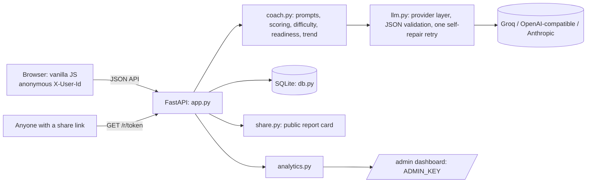
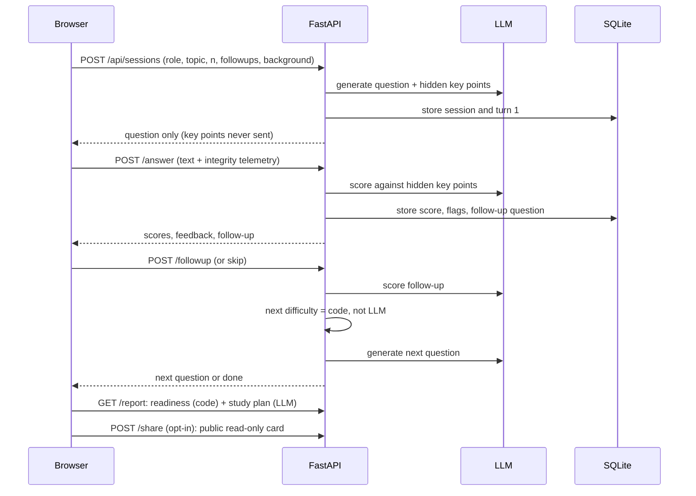

# PrepPilot architecture

## System overview

## One interview turn

## Data and trust boundaries
| Data | Who can read it |
|---|---|
| Questions, answers, scores | Only the browser that created the session (`X-User-Id`); other users get 404 |
| Hidden rubric (key points) | Server only |
| Shared report card (`/r/<token>`) | Anyone with the link: score, strengths, weaknesses, 7-day plan. Never questions, answers or user ids. Revocable; removed by "Delete my data" |
| Admin analytics | Holder of `ADMIN_KEY`; aggregates only, no answers or user ids |

## Roadmap design: coding questions (not built)
Most valuable for engineers, but the hardest to do safely, so it is deliberately out of v1.
- **Editor:** Monaco or CodeMirror in the browser; problems carry hidden test cases, like the hidden rubric.
- **Execution:** never run candidate code in the app process. Options in order of effort: (1) run in the browser with Pyodide or a JS worker, which keeps untrusted code off the server but is weaker against cheating; (2) a hosted sandbox API such as Judge0; (3) self-hosted containers with no network, CPU, memory and time limits, a read-only filesystem and a queue.
- **Scoring:** tests pass/fail decide correctness in code; the LLM only comments on approach and complexity, so the score is explainable.
- **Risks:** sandbox escape, cost abuse, test leakage, and the integrity checks do not transfer cleanly to code (paste is normal in an editor).
- **Gate:** build only after text sessions show activation and repeat use (see PRD §4 and §7).
